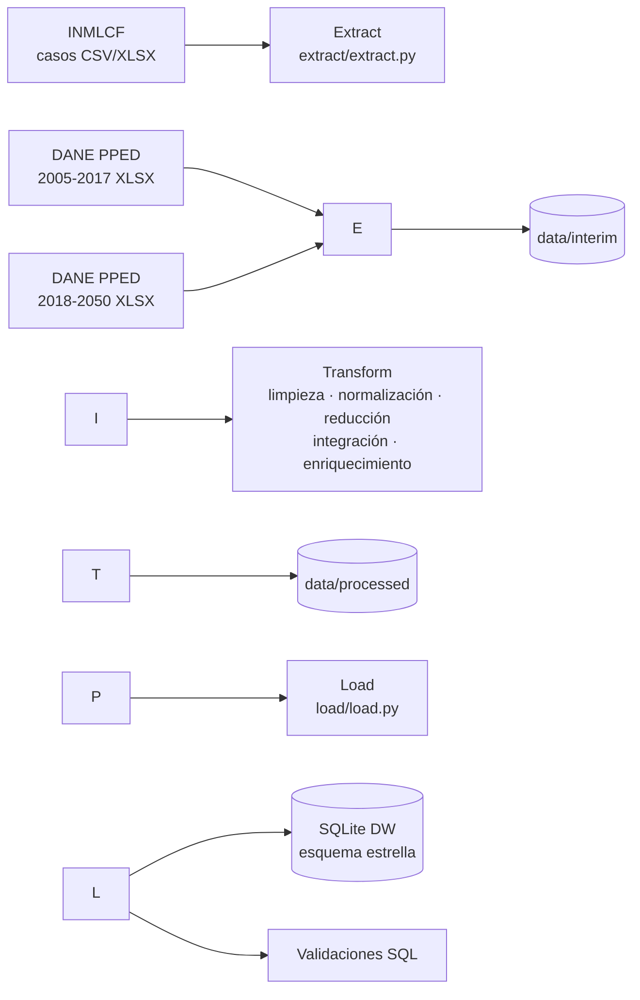

# Tasa de presuntos suicidios en Colombia por departamento, sexo y edad (2015-2024)

> Pipeline ETL que toma los casos de presuntos suicidios del INMLCF y las proyecciones de población del DANE, los limpia, homologa e integra para calcular tasas por 100.000 habitantes, y los carga en un data warehouse SQLite con esquema estrella.

**Curso:** ETL — Maestría en Inteligencia Artificial y Ciencia de Datos, Universidad Autónoma de Occidente
**Periodo:** 2026-2
**Docente:** Fernando Barraza Alvarado

## Integrantes

|Nombre|Código|Usuario de GitHub|
|-|-|-|
|William Andrés Linarez Salazar|\[código]||
|Larry Olarte|\[código]|\larryjol|

## Tabla de contenido

1. [Descripción del problema](#1-descripción-del-problema)
2. [Fuentes de datos](#2-fuentes-de-datos)
3. [Arquitectura del pipeline](#3-arquitectura-del-pipeline)
4. [Estructura del repositorio](#4-estructura-del-repositorio)
5. [Requisitos](#5-requisitos)
6. [Instalación y configuración](#6-instalación-y-configuración)
7. [Ejecución](#7-ejecución)
8. [Detalle de las etapas ETL](#8-detalle-de-las-etapas-etl)
9. [Modelo y diccionario de datos](#9-modelo-y-diccionario-de-datos)
10. [Calidad de datos y validaciones](#10-calidad-de-datos-y-validaciones)
11. [Resultados](#11-resultados)
12. [Limitaciones y trabajo futuro](#12-limitaciones-y-trabajo-futuro)
13. [Referencias](#13-referencias)

## 1\. Descripción del problema

El Instituto Nacional de Medicina Legal y Ciencias Forenses (INMLCF) publica los casos de presuntos suicidios como conteos por caso, sin relacionarlos con la población de cada territorio. Comparar conteos entre departamentos sesga la lectura hacia los más poblados: Antioquia, Bogotá y Valle del Cauca son los tres primeros en número de casos, pero no en riesgo. Para comparar riesgo hace falta una tasa, y para calcularla hay que integrar los casos con las proyecciones de población del DANE por las mismas categorías de departamento, año, sexo y grupo de edad.

Los datos resultantes sirven a entidades de vigilancia epidemiológica, al Ministerio de Salud y a las secretarías departamentales de salud para priorizar recursos de prevención, y a la siguiente etapa del proyecto para modelar qué factores demográficos se asocian con una mayor tasa.

**Objetivo:** dejar disponible una tabla integrada de casos, población y tasa por 100.000 habitantes a nivel de departamento × año × sexo × grupo de edad (2015-2024), cargada en un data warehouse con esquema estrella, lista para análisis descriptivo y para un modelo de conteos que admita sobredispersión.

## 2\. Fuentes de datos

|Fuente|Tipo|Origen / URL|Tamaño aprox.|Frecuencia de actualización|Licencia|
|-|-|-|-|-|-|
|Presuntos suicidios Colombia 2015-2024, cifras definitivas (INMLCF)|CSV o XLSX|[datos.gov.co](https://www.datos.gov.co) (buscar «Presuntos Suicidios Colombia 2015-2024»)|26.558 filas × 32 columnas|Anual|Datos abiertos del Estado colombiano|
|Proyecciones de población departamental por área, sexo y edad 2005-2017 (DANE, PPED)|XLSX|[DANE – Proyecciones de población](https://www.dane.gov.co/index.php/estadisticas-por-tema/demografia-y-poblacion/proyecciones-de-poblacion)|1.287 filas × 310 columnas|Por actualización metodológica|Información pública del DANE|
|Proyecciones de población departamental por área, sexo y edad 2018-2050 (DANE, PPED, actualizada el 30-jul-2025)|XLSX|[DANE – Proyecciones de población](https://www.dane.gov.co/index.php/estadisticas-por-tema/demografia-y-poblacion/proyecciones-de-poblacion)|2.945 filas × 310 columnas|Por actualización metodológica|Información pública del DANE|

## 3\. Arquitectura del pipeline



Las fuentes son archivos que se publican una vez al año, así que el pipeline corre por lotes y reconstruye el resultado completo en cada ejecución. La etapa de extracción deja una copia uniforme en `data/interim` para que cada etapa pueda correr por separado. La transformación sigue el plan de la Entrega 2, organizado en cinco etapas. El destino es SQLite porque no requiere servidor ni credenciales, el volumen es pequeño y permite un esquema estrella con llaves foráneas y validaciones en SQL. `pipeline.py` usa Prefect si está instalado; si no, ejecuta las mismas etapas como script.

**Tecnologías:** Python 3.11, pandas, NumPy, openpyxl, SQLite (`sqlite3`), matplotlib y Prefect (opcional).

## 4\. Estructura del repositorio

```
├── data
│   ├── raw            <- Datos originales, sin modificar (INMLCF y DANE).
│   ├── interim        <- Copia tabular de las fuentes generada por extract (no se sube a git).
│   ├── processed      <- Datos finales: casos limpios, tabla integrada, tasas y reportes de calidad.
│   └── warehouse      <- Data warehouse SQLite generado por load (no se sube a git).
│
├── extract            <- extract.py: lectura de las tres fuentes.
├── transform          <- transform.py: limpieza, normalización, reducción, integración y enriquecimiento.
├── load               <- load.py: carga al esquema estrella y validaciones SQL.
├── sql                <- consultas.sql: consultas de ejemplo y validaciones sobre el DW.
├── docs               <- Figuras de resultados, salida de ejecución y script que genera las figuras.
├── notebooks          <- Notebook exploratorio de la Entrega 2 (EDA y calidad de datos).
├── tests              <- Pruebas unitarias de las transformaciones (unittest).
│
├── config.py          <- Rutas, nombres de archivos y constantes del pipeline.
├── pipeline.py        <- Orquesta la ejecución completa (extract → transform → load).
├── requirements.txt   <- Dependencias del proyecto.
├── .env.example       <- Variables de entorno opcionales (rutas).
├── .gitignore         <- Archivos que git debe ignorar.
└── README.md          <- Este archivo.
```

## 5\. Requisitos

* Python 3.11 o superior
* No requiere base de datos externa: SQLite viene incluido en Python
* Dependencias listadas en `requirements.txt`

## 6\. Instalación y configuración

```bash
# 1. Clonar el repositorio
git clone https://github.com/larryjol/etl-suicidios-colombia.git
cd etl-suicidios-colombia

# 2. Crear y activar el entorno virtual
python -m venv .venv
source .venv/bin/activate        # Windows: .venv\\Scripts\\activate

# 3. Instalar dependencias
pip install -r requirements.txt

# (Opcional) Orquestación con Prefect
pip install prefect
```

### Variables de entorno

El pipeline no usa credenciales. Las rutas tienen valores por defecto dentro del repositorio; solo si quiere cambiarlas, copie `.env.example` como `.env` o defina las variables en su terminal:

|Variable|Descripción|Ejemplo|
|-|-|-|
|`ETL\_DATA\_DIR`|Carpeta base de datos (contiene `raw/`, `interim/`, `processed/`, `warehouse/`)|`./data`|
|`ETL\_DB\_PATH`|Ruta del data warehouse SQLite|`./data/warehouse/dw\_suicidios.db`|

### Obtención de los datos

Los tres archivos fuente están en `data/raw` (11 MB en total), así que el pipeline corre sin descargas. Para actualizar los datos:

1. **INMLCF:** descargar desde [datos.gov.co](https://www.datos.gov.co) el conjunto «Presuntos Suicidios Colombia 2015-2024» en CSV y guardarlo en `data/raw`. El pipeline toma cualquier archivo `Presuntos\_Suicidios\*.csv`; si no hay CSV, usa el XLSX.
2. **DANE:** descargar desde la página de [Proyecciones de población](https://www.dane.gov.co/index.php/estadisticas-por-tema/demografia-y-poblacion/proyecciones-de-poblacion) los archivos departamentales por área, sexo y edad (2005-2017 y 2018-2050) y guardarlos en `data/raw` con los nombres definidos en `config.py`.

## 7\. Ejecución

```bash
# Pipeline completo
python pipeline.py
```

```bash
# Por etapas
python extract/extract.py
python transform/transform.py
python load/load.py

# Figuras de resultados y pruebas
python docs/generar\_figuras.py
python -m unittest discover tests
```

**Salida esperada:** en `data/processed` quedan `casos\_limpios.csv`, `tabla\_integrada.csv`, `tasas\_departamento.csv`, `departamentos.csv`, `reporte\_calidad.json` y `validaciones\_carga.json`; en `data/warehouse` queda `dw\_suicidios.db`. La ejecución completa tarda cerca de 30 segundos (la lectura de los Excel es lo más lento).

## 8\. Detalle de las etapas ETL

### 8.1 Extract

* **Qué hace:** lee las tres fuentes locales sin modificar su contenido. Para el DANE 2005-2017 toma el encabezado de la fila 12; para el DANE 2018-2050 lee la hoja `PobDepartamentalxÁreaSexoEdad`, cuyo encabezado ocupa dos filas, y nombra sus cuatro primeras columnas igual que en el otro archivo.
* **Scripts:** `extract/extract.py`
* **Salida:** `data/interim/casos\_raw.csv`, `data/interim/poblacion\_2005\_2017\_raw.csv`, `data/interim/poblacion\_2018\_2050\_raw.csv`

### 8.2 Transform

* **Qué hace:** aplica el plan de transformaciones de la Entrega 2 en cinco etapas: limpieza, normalización, reducción de dimensiones, integración y enriquecimiento.
* **Scripts:** `transform/transform.py`
* **Salida:** `data/processed/casos\_limpios.csv`, `tabla\_integrada.csv`, `tasas\_departamento.csv`, `reporte\_calidad.json`

|#|Etapa|Transformación|Justificación|
|-|-|-|-|
|1|Limpieza|Reparar texto UTF-8 leído como Latin-1 y códigos `\_x00HH\_` de Excel|La exportación XLSX trae 283.405 celdas con caracteres corruptos (`Bogotá`); el CSV no las tiene y la función no lo altera|
|2|Limpieza|Quitar espacios en los nombres de columna|El CSV de datos.gov.co trae `Grupo de Edad Quinquenal ` con espacio final|
|3|Limpieza|Convertir a nulo «Sin información», «No había sido implementada», «No sabe / No informa» y «Por determinar»|Son faltantes escritos como texto y se contarían como categorías válidas|
|4|Limpieza|Excluir los 4 casos con código de departamento 999|No se pueden asignar a una población|
|5|Limpieza|Eliminar columnas constantes (`Manera de Muerte`, `Circunstancia del Hecho Detallada`)|Tienen un único valor y no aportan información|
|6|Normalización|Unificar mayúsculas, tildes y espacios, y homologar equivalencias semánticas (escolaridad, mayoría de edad, mecanismo)|Cada año usa reglas de escritura distintas: Mes pasa de 24 a 12 categorías, Día de 14 a 7 y Escolaridad de 18 a 8|
|7|Reducción|Excluir razón del suicidio, rango horario, localidad, orientación sexual, identidad de género, transgénero y pertenencia étnica|Más del 50 % sin información o sin serie completa 2015-2024; imputarlas inventaría información|
|8|Reducción|Agrupar en «Otros» los mecanismos con menos de 20 casos|Cuatro mecanismos concentran el 97,7 % de los casos y los raros no permiten estimaciones estables|
|9|Integración|Homologar columnas de los dos archivos DANE (`Hombres\_0` / `Hombres 0 años`, `Cabecera` / `Cabecera Municipal`) y quitar notas al pie|Los archivos tienen esquemas distintos|
|10|Integración|Pivotar la población de formato ancho a largo y usar solo el área «Total»|Cruzar por sexo y edad exige formato largo; cabecera + rural suman exactamente el total|
|11|Integración|Construir los 17 grupos de edad del INMLCF (separa 15-17 y 18-19) desde la edad simple y excluir 0-4 años del denominador|Las dos fuentes deben tener los mismos grupos; el INMLCF no registra casos en 0-4 años|
|12|Integración|Cruzar por código DANE de departamento (`cod\_dpto`) con *left join* desde la población|El nombre cambia entre años y archivos; el *left join* deja en 0 las combinaciones sin casos en lugar de perderlas|
|13|Enriquecimiento|Calcular tasa por 100.000, columna `serie` del archivo de población, marca de 2024 provisional y bandera de baja confiabilidad (< 5 casos)|Cambio de serie poblacional 2017→2018, faltantes distintos en 2024 y 84,4 % de celdas con menos de 5 casos|
|14|Enriquecimiento|Tasa ajustada por edad y sexo (método directo, población estándar Colombia 2020) y SMR (método indirecto) por departamento|Comparar departamentos con estructuras de edad distintas|

### 8.3 Load

* **Qué hace:** construye un esquema estrella (1 tabla de hechos y 3 dimensiones), carga además la tabla de casos limpios y la de tasas por departamento, y ejecuta las validaciones SQL. Modo: reemplazo completo en cada ejecución. Si una validación falla, el script se detiene con error.
* **Scripts:** `load/load.py`
* **Destino:** `data/warehouse/dw\_suicidios.db` (SQLite)

## 9\. Modelo y diccionario de datos

```mermaid
erDiagram
    hechos\_suicidio }o--|| dim\_departamento : cod\_dpto
    hechos\_suicidio }o--|| dim\_tiempo : anio
    hechos\_suicidio }o--|| dim\_demografia : id\_demografia
    hechos\_suicidio {
        TEXT cod\_dpto PK, FK
        INTEGER anio PK, FK
        INTEGER id\_demografia PK, FK
        INTEGER casos
        INTEGER poblacion
        REAL tasa\_100k
        INTEGER baja\_confiabilidad
    }
    dim\_departamento {
        TEXT cod\_dpto PK
        TEXT nombre
        TEXT region
    }
    dim\_tiempo {
        INTEGER anio PK
        TEXT serie\_poblacion
        INTEGER anio\_provisional
        INTEGER anio\_pandemia
    }
    dim\_demografia {
        INTEGER id\_demografia PK
        TEXT sexo
        TEXT grupo\_edad
        TEXT ciclo\_vida
        INTEGER mayor\_de\_edad
    }
```

**Tabla:** `hechos\_suicidio` (11.220 filas = 33 departamentos × 10 años × 2 sexos × 17 grupos de edad)

|Columna|Tipo|Descripción|Ejemplo|
|-|-|-|-|
|`cod\_dpto`|TEXT|Código DANE del departamento (2 dígitos)|`05`|
|`anio`|INTEGER|Año del hecho|`2015`|
|`id\_demografia`|INTEGER|Combinación de sexo y grupo de edad (ver `dim\_demografia`)|`2`|
|`casos`|INTEGER|Presuntos suicidios registrados por el INMLCF|`7`|
|`poblacion`|INTEGER|Población proyectada por el DANE para esa combinación|`255519`|
|`tasa\_100k`|REAL|`casos / poblacion × 100.000`|`2.74`|
|`baja\_confiabilidad`|INTEGER|1 si la celda tiene menos de 5 casos|`0`|

**Dimensiones:**

|Tabla|Columna|Tipo|Descripción|Ejemplo|
|-|-|-|-|-|
|`dim\_departamento`|`cod\_dpto`|TEXT|Código DANE|`05`|
||`nombre`|TEXT|Nombre oficial (archivo DANE más reciente)|`Antioquia`|
||`region`|TEXT|Región natural|`Andina`|
|`dim\_tiempo`|`anio`|INTEGER|Año|`2018`|
||`serie\_poblacion`|TEXT|Archivo DANE del que sale el denominador|`2018-2050`|
||`anio\_provisional`|INTEGER|1 para 2024 (patrón de faltantes distinto)|`0`|
||`anio\_pandemia`|INTEGER|1 para 2020|`0`|
|`dim\_demografia`|`id\_demografia`|INTEGER|Llave|`2`|
||`sexo`|TEXT|`Hombre` / `Mujer`|`Hombre`|
||`grupo\_edad`|TEXT|Uno de los 17 grupos del INMLCF|`10-14`|
||`ciclo\_vida`|TEXT|Infancia, Adolescencia, Juventud, Adultez, Adulto mayor|`Adolescencia`|
||`mayor\_de\_edad`|INTEGER|1 desde el grupo 18-19|`0`|

**Tablas de apoyo en el DW:** `casos\_inmlcf` (26.554 casos limpios, 26 columnas) y `tasas\_departamento` (33 filas con casos, personas-año, tasa cruda, tasa ajustada, SMR y puestos).

**Archivo:** `data/processed/tabla\_integrada.csv` tiene la misma información de la tabla de hechos en formato plano, con `departamento`, `serie`, `sexo`, `grupo\_edad` y `anio\_provisional` como columnas.

## 10\. Calidad de datos y validaciones

Las cifras salen de `data/processed/reporte\_calidad.json` y `data/processed/validaciones\_carga.json`, que el pipeline genera en cada ejecución.

|Verificación|Antes|Después|
|-|-|-|
|Registros de casos|26.558|26.554 (se excluyen 4 sin departamento)|
|Columnas de la base de casos|32|23 originales + 3 derivadas|
|Celdas con texto mal codificado (fuente XLSX)|283.405|0|
|Faltantes escritos como texto|155.231|0 (convertidos a nulo)|
|IDs duplicados|0|0|
|Registros idénticos sin contar el ID|1|1 (se conserva: tiene ID propio y puede ser otra víctima)|
|Categorías de Mes / Día / Escolaridad|24 / 14 / 18|12 / 7 / 8|
|Casos sin población asociada|—|0|
|Casos en la tabla integrada y en el DW|26.554|26.554 (cuadre OK)|
|Filas de la tabla de hechos|—|11.220|
|Duplicados en la llave de la tabla de hechos|—|0|
|Hechos huérfanos (departamento / tiempo / demografía)|—|0 / 0 / 0|
|Filas con población ≤ 0 o casos < 0|—|0|
|Nulos en columnas llave|—|0|

Las pruebas de `tests/test\_transform.py` verifican la reparación de texto, los grupos de edad, la limpieza y la normalización, y que la tabla integrada tenga 11.220 filas únicas, sin nulos en llaves y con la tasa bien calculada:

```bash
python -m unittest discover tests      # Ran 8 tests ... OK
```

## 11\. Resultados

El pipeline integra el 100 % de los casos con departamento conocido (26.554) con su población, sin pérdidas. La tasa nacional 2015-2024 en población de 5 años y más es de **5,80 por 100.000**: 9,55 en hombres y 2,22 en mujeres. La tasa ajustada por edad y sexo cambia por completo el orden que dan los conteos: Antioquia, Bogotá y Valle del Cauca son 1.º, 2.º y 3.º en casos, pero Vaupés (16,96) y Arauca (11,38) encabezan las tasas.

**Salida de la ejecución** (`docs/salida\_pipeline.txt`):

```
\[EXTRACT]
  casos                   26,558 filas x 32 columnas
  poblacion\_2005\_2017      1,287 filas x 310 columnas
  poblacion\_2018\_2050      2,945 filas x 310 columnas
\[TRANSFORM]
  casos limpios         26,554 registros x 26 columnas
  tabla integrada       11,220 filas, 26,554 casos
  casos sin población        0
\[LOAD]
  destino              data/warehouse/dw\_suicidios.db
  filas\_hechos             11220
  casos\_en\_dw              26554
  duplicados\_llave         0
  huerfanos\_departamento   0
  huerfanos\_tiempo         0
  huerfanos\_demografia     0
  poblacion\_no\_positiva    0
  casos\_negativos          0
  registros\_casos\_inmlcf   26554
  casos\_esperados          26554
  cuadre\_casos             OK
```

**Consulta de ejemplo** (más en `sql/consultas.sql`):

```sql
-- Tasa por 100.000 habitantes por región natural y sexo, 2015-2024
SELECT d.region,
       m.sexo,
       SUM(h.casos)                                         AS casos,
       ROUND(SUM(h.casos) \* 100000.0 / SUM(h.poblacion), 2) AS tasa\_100k
FROM hechos\_suicidio h
JOIN dim\_departamento d ON h.cod\_dpto = d.cod\_dpto
JOIN dim\_demografia  m ON h.id\_demografia = m.id\_demografia
GROUP BY d.region, m.sexo
ORDER BY tasa\_100k DESC;
```

|region|sexo|casos|tasa\_100k|
|-|-|-|-|
|Andina|Hombre|13.434|10,90|
|Amazonía|Hombre|504|10,85|
|Orinoquía|Hombre|934|10,74|
|Pacífica|Hombre|3.131|8,52|
|Insular|Hombre|22|7,91|
|Caribe|Hombre|3.322|6,67|
|Amazonía|Mujer|164|3,64|
|Orinoquía|Mujer|238|2,80|
|Andina|Mujer|3.246|2,49|
|Pacífica|Mujer|918|2,32|
|Caribe|Mujer|640|1,25|
|Insular|Mujer|1|0,34|

!\[Casos frente a tasa ajustada por departamento](docs/tasas\_departamento.png)

!\[Tasa por año y sexo](docs/tasa\_anual\_sexo.png)

## 12\. Limitaciones y trabajo futuro

* El INMLCF solo registra los casos presuntos que llegan al sistema médico-legal. Las tasas bajas de algunos departamentos (Chocó, Vichada, La Guajira) pueden reflejar subregistro y no menor riesgo; Vaupés, por ejemplo, no registra casos en 2015-2016 y entre 6 y 11 por año después.
* Los denominadores de 2015-2017 y 2018-2024 vienen de dos versiones de las proyecciones del DANE. La columna `serie\_poblacion` permite repetir los análisis solo con 2018-2024.
* El 84,4 % de las celdas departamento × año × sexo × edad tiene menos de 5 casos, y la dispersión entre departamentos es muy superior a la que produciría el azar (índice de Pearson de 56,9 tras estandarizar por edad y sexo). Las tasas crudas por celda no deben leerse de forma aislada; la etapa analítica debe usar un modelo de conteos con la población como *offset* y que admita sobredispersión (binomial negativa o efectos aleatorios por departamento).
* 2024 se marca como provisional por su patrón de faltantes distinto; los resultados deben reportarse con y sin ese año.
* Trabajo futuro: descargar los datos automáticamente desde la API de datos.gov.co, carga incremental por año, desagregar la población por zona urbana/rural y programar el flujo en Prefect Cloud.

## 13\. Referencias

* Instituto Nacional de Medicina Legal y Ciencias Forenses. *Presuntos Suicidios Colombia 2015-2024, cifras definitivas*. Portal de datos abiertos [datos.gov.co](https://www.datos.gov.co).
* DANE. *Proyecciones de población y estudios demográficos (PPED) – nivel departamental por área, sexo y edad*, series 2005-2017 y 2018-2050. [dane.gov.co](https://www.dane.gov.co/index.php/estadisticas-por-tema/demografia-y-poblacion/proyecciones-de-poblacion).
* DANE. *Nota técnica – Proyecciones de población, actualización julio 2025*. [PDF](https://www.dane.gov.co/files/censo2018/proyecciones-de-poblacion/Nacional/NotaTecnica-PPED-jul2025.pdf).
* Material del curso ETL 2026-2 (prácticas de extracción, calidad de datos, normalización, outliers, Prefect, SQL y modelado dimensional).
* Uso de herramientas de IA generativa: se usó Claude (Anthropic) como apoyo en la exploración de los datos, la revisión y estructuración del código y la redacción de la documentación. Las decisiones de diseño y los resultados fueron revisados por los integrantes.

